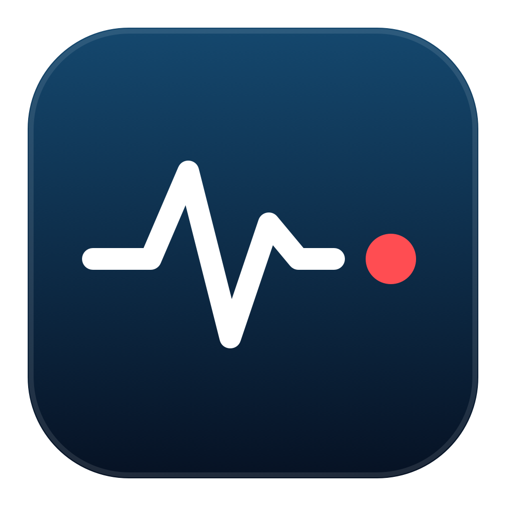
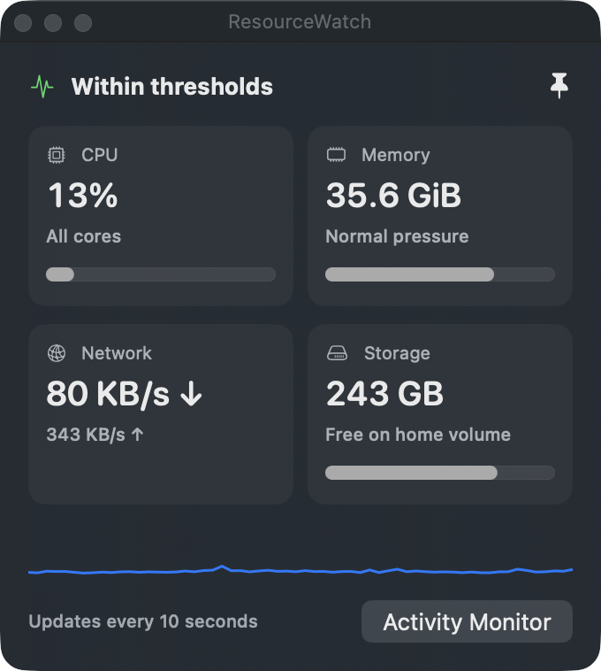
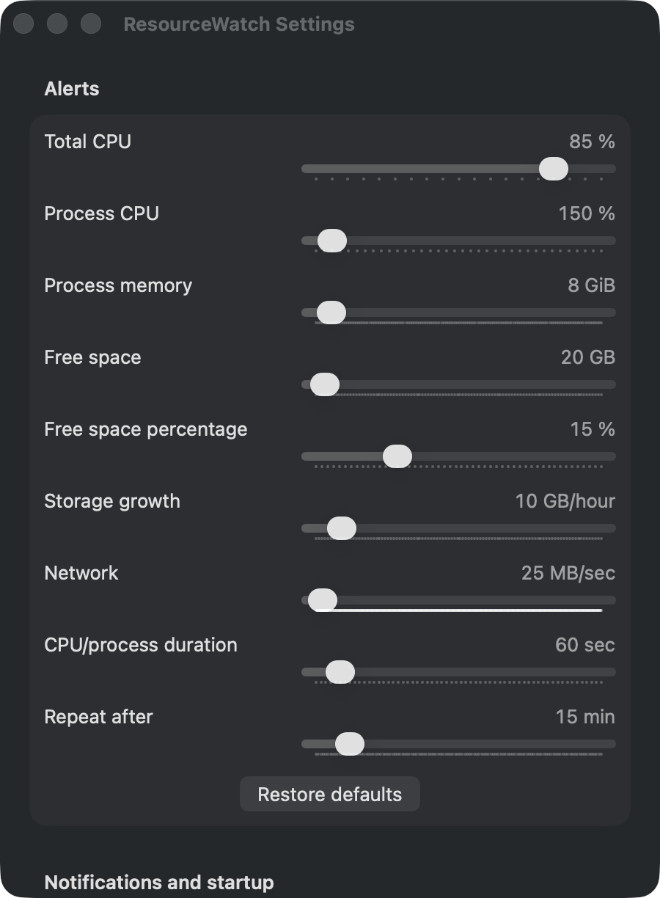

# ResourceWatch



Standalone macOS menu bar monitor. Swift 6, macOS 14+, no dependencies, network calls, administrator access, automatic process termination, or disk deletion.

Free and open source under the [MIT license](LICENSE). No account, API key, subscription or hosted service is required.

## Screenshots

### Live mini panel



### Alert thresholds



Actual app captures with example live readings and selected thresholds. Click a metric tile for details; adjust the sliders to suit your Mac.

## Install and run

Requirements: a Mac running macOS 14 or later, Git, and full Xcode 16 or later (Swift 6 and the asset-catalog compiler). Standalone Command Line Tools are insufficient for app-icon compilation. The current implementation was tested on Apple Silicon; Intel has not been validated.

```bash
git clone https://github.com/3257/ResourceWatch.git
cd ResourceWatch
bash build.sh
open dist/ResourceWatch.app
```

The build creates a locally ad-hoc signed app. It does not need an Apple Developer account and is not a notarized release download. The app lives in the menu bar, without a Dock icon. To install at a stable location, copy `dist/ResourceWatch.app` to `~/Applications` (create that folder if necessary), quit any running copy, and open the installed copy before enabling login startup.

1. Click the pulse icon and choose **Enable notifications**; approve the macOS prompt.
2. Choose **Send test notification** to check delivery.
3. Open **Settings…** to adjust the sliders and optionally enable login startup or menu bar percentages.
4. Choose **Show mini panel** for the live dashboard. Its pin keeps it above other windows; closing it leaves monitoring running.
5. Choose **Quit ResourceWatch** from the menu to stop monitoring.

After pulling updates, run `bash build.sh` again and replace your installed copy while the old app is quit. To uninstall, turn off **Launch at login**, quit the app and delete its app bundle. Preferences remain in the local `local.resourcewatch.app` defaults domain.

## Features and thresholds

Build with `bash build.sh`, then `open dist/ResourceWatch.app`. Open its pulse icon menu and choose **Enable notifications**. macOS notification settings and Focus modes can suppress delivery. The app must remain running; login launch is not installed automatically.

The pulse icon stays in place and gains a small red status dot when current metrics exceed configured thresholds or sampling fails; the dot disappears after recovery. The icon reserves the same space in both states, and adapts to light/dark appearance. Visual warnings appear on the current sample, while notifications wait for the configured sustained duration. In Settings, **Show CPU and RAM in menu bar** adds compact live percentages beside the icon (off by default).

When a warning is active, **Current warnings** appears at the top of the menu with the reason, current readings and responsible process names where available. For example: `CPU 90% — above 85%` or `FixtureCompiler: 500% CPU (one core = 100%)`. Storage growth is distinguished from low free space. Click a warning to open the mini panel; recovered warnings disappear from this section while past notifications remain under **Recent alerts**.

### Suggestions and storage cleanup

**Suggestions** appears below the warnings and states what to do. ResourceWatch groups helper processes under their app, so a warning names the app and not one helper. For example: `Google Chrome: 11.2 GiB RAM in 34 processes`. Each suggestion opens a submenu with the largest process, a tip and one or more actions:

- **Bring app to front**, **Open Activity Monitor**, **Reveal in Finder**.
- **Copy command**: copies a cleanup command, such as `xcrun simctl delete unavailable` or `git -C … worktree remove …`, to the clipboard. You paste it into Terminal and run it yourself.

**Ask AI in Terminal** (menu) or **Ask AI** (mini panel) sends a suggestion to an AI coding CLI. ResourceWatch detects Claude Code (`claude`), Codex (`codex`), OpenCode (`opencode --prompt`) and Gemini CLI (`gemini -i`) through your login shell's `PATH` at launch, and lists only the installed ones. The app opens a `.command` file with your default terminal app. The agent starts an interactive session in your login shell, with the suggestion, your Mac's memory and storage readings, and a rule to ask before it deletes files or stops processes. Worktree suggestions start in the worktree folder; other suggestions start in your home folder. The terminal opens a new window, or a new tab when **System Settings → Desktop & Dock → Prefer tabs when opening documents** is **Always**. No Automation or Accessibility permission is needed.

ResourceWatch never deletes files and never quits apps. Summed resident memory counts shared pages once per process, so app totals are approximate. macOS does not tell other apps which browser tab owns a process; for Chromium browsers the tip points to the browser's Task Manager (Shift+Esc).

The **Storage cleanup** submenu lists items of 1 GB or more, largest first:

- Known developer and cache folders: Xcode DerivedData, Archives and DeviceSupport, simulator devices, Swift Package Manager, Homebrew, CocoaPods, npm and Gradle caches, the Trash, device backups, and Downloads items unchanged for 30 days.
- Xcode DerivedData folders whose project no longer exists.
- Git worktrees in your project folders whose branch is merged into the default branch, or that have no git activity for 14 days. A worktree's size includes its Xcode DerivedData folders.

Set the project folders in **Settings… → Project folders**; the defaults are `~/WorkProjects` and `~/PlayProjects`. ResourceWatch reads git's worktree records directly and runs `git` only during a scan, to find merged branches.

A scan runs at launch, again after 24 hours, and at most once an hour while a low-storage or storage-growth warning is active. **Scan now** starts one at any time. Scans run at background priority, outside the ten-second sampler, and stop measuring a folder after 20 seconds (the size then shows as "at least"). Folders that macOS protects, such as Downloads, are scanned only after the first **Scan now**, so macOS asks for access when you expect it. Folders that need Full Disk Access are skipped. Low-storage and growth notifications name the largest cleanup item, and process notifications add the app tip.

Choose **Show mini panel** for a small floating dashboard with CPU, memory, network and storage tiles plus up to ten minutes of CPU history. Click a tile for details and click it again to collapse. The pin button toggles staying above other windows. Closing the panel leaves monitoring running. This is a live app panel, not a macOS WidgetKit desktop widget, and shares the existing ten-second sampler.

Samples every ten seconds, off the UI thread:

- All-core CPU above 85% for 60 seconds.
- Individual process above 150% CPU (one and a half cores) for 60 seconds, even if overall CPU is low.
- Individual process above 8 GiB resident memory for 60 seconds.
- macOS warning/critical memory pressure for 30 seconds. Swap is displayed separately; swap alone does not imply a problem.
- Home volume below 20 GB free or 10% free for 30 seconds.
- More than 10 GB lost over a rolling hour, after at least five minutes of observation.
- Upload or download above 25 MB/s for 60 seconds (adjustable). This indicates sustained traffic, not a claim the connection is saturated.

Alerts repeat every 15 minutes while a condition persists. Recovery resets the sustained window. The menu retains the latest 30 alerts in memory. Disk history resets on restart and measures free-space change, not attribution to a folder. The sampler never scans folders; only storage cleanup scans measure folder sizes. APFS shared capacity and snapshots can affect free space.

Top processes show PID, executable name, CPU since the previous sample and RSS. CPU counters use the machine's Mach timebase; 100% means one core. RSS is not Activity Monitor's memory footprint. Some protected processes cannot be inspected and are omitted. Command arguments and environments are never collected. Sampling uses native APIs on a serial utility queue, with no subprocess per tick.

The compact native menu shows CPU, memory pressure, swap and storage. **Top processes** and **Recent alerts** expand into submenus. Open **Settings…** to adjust thresholds, CPU/process duration and cooldown with sliders; selected values remain visible beside their labels. **Launch at login** is a separate toggle. Preferences persist locally. Memory pressure and low space use a fixed 30-second window. Login startup is opt-in through Apple's Service Management API; the toggle reads the OS state. Keep the app at a stable path before enabling it. macOS may require approval in Login Items settings. Quitting stops monitoring until the next launch.

The **RAM** submenu adds estimated used/physical memory, compressed/wired memory and the five largest resident processes. The estimate uses resident internal pages minus purgeable pages, plus wired and compressor pages. Pressure remains the basis of system-memory alerts: a large cache or old swap does not necessarily mean trouble.

The **Network** submenu shows download/upload rates and totals since launch, measured from 64-bit Wi-Fi/Ethernet (`en*`) interface counters. Local transfers are included. VPN tunnel/bridge/loopback counters are excluded to avoid counting tunneled traffic twice; this is not a universal internet-usage meter, and other interface types are not included. No packet inspection, destination collection, connectivity probes, or per-process network attribution. New/reconnected interfaces establish a baseline; counter resets do not create traffic spikes. Totals reset when the app quits.

Use **Send test notification** to verify permission and banner delivery. A successful submission is not proof a banner appeared: Focus and OS presentation settings still apply. The app requests foreground banner/list/sound presentation too.

Run tests with `swift test`. Tests cover sustained windows, cooldown, quiet high-swap conditions, CPU/process/memory/disk alerts, disk growth, sampling gaps, PID reuse, isolated settings persistence, live metrics, app grouping and tips, folder sizing, scan scheduling, git worktree and DerivedData detection with a temporary repository, and native CPU scaling with a disposable 0.4-second busy child. No stress test of system RAM or disk is needed.

## Development

```bash
swift test
bash build.sh
git diff --check
```

Code is in `Sources/ResourceWatch`; regression tests are in `Tests/ResourceWatchTests`. [VALIDATION.md](VALIDATION.md) describes recorded checks and limitations. The ignored `.build` folder is a disposable SwiftPM cache; `dist` contains local app bundles. Neither belongs in a source commit.

`scripts/generate_icon.swift` contains the original vector artwork and generates every macOS icon size using AppKit and `iconutil`. `build.sh` also compiles a named AppIcon asset with Xcode's `actool`, embeds both `Assets.car` and `AppIcon.icns`, and declares the icon file/name in the bundle metadata. Building now requires full Xcode, including the asset compiler. The static app icon uses a red brand dot; the separate menu bar dot still reflects live warnings. Test notification titles include the running app version so older notifications can be distinguished from fresh tests.

## Privacy

Metrics stay on the Mac. There is no telemetry, backend, packet capture, destination inspection or credential access. Process inspection collects executable names, PIDs, CPU counters and resident sizes, not command arguments or environments. Notifications can include executable names; their visibility follows your macOS notification settings. Settings are stored in local UserDefaults; short metric history and recent alerts live in memory. No credentials, raw diagnostic logs, build products or machine-specific configuration are needed in this repository. Documentation screenshots show only app windows with aggregate metrics and settings, without desktop content or process details.

Implementation references: [Apple memory pressure sysctl conversion](https://github.com/apple-oss-distributions/xnu/blob/main/bsd/kern/kern_memorystatus_notify.c), [login startup](https://developer.apple.com/documentation/servicemanagement/smappservice/mainapp), [notification presentation](https://developer.apple.com/documentation/usernotifications/unusernotificationcenterdelegate/usernotificationcenter(_:willpresent:withcompletionhandler:)).
