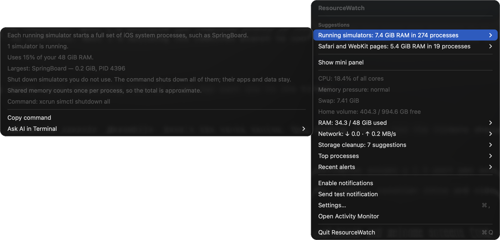
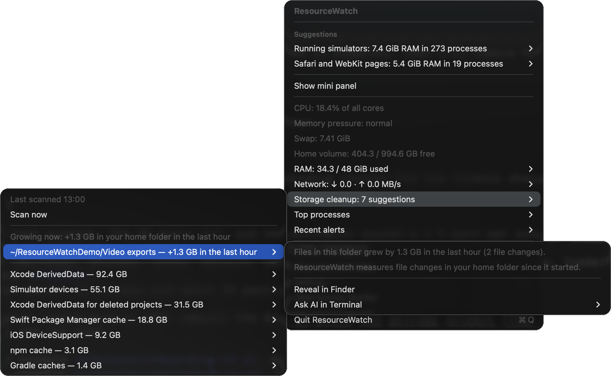
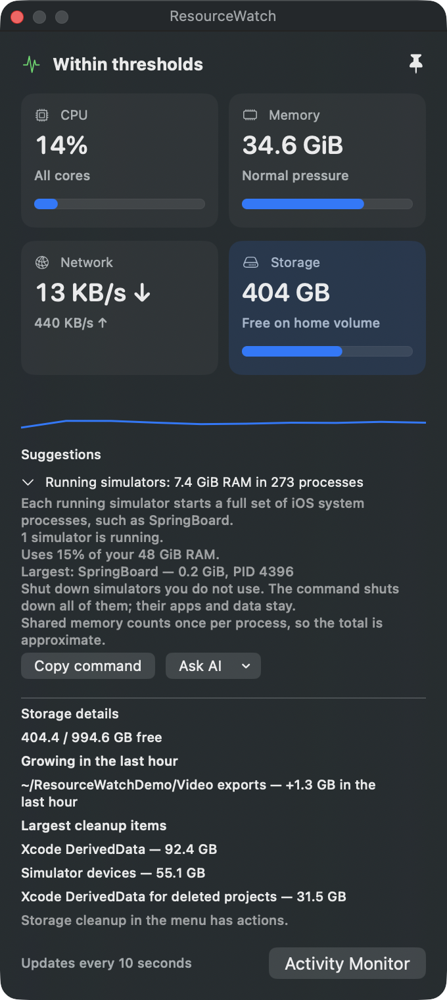

# ResourceWatch

[](https://github.com/3257/ResourceWatch/actions/workflows/ci.yml) [](https://github.com/3257/ResourceWatch/releases/latest) [](LICENSE)


Standalone macOS menu bar monitor. Swift 6, macOS 14+, no dependencies, network calls, administrator access, automatic process termination, or automatic file deletion.

Free and open source under the [MIT license](LICENSE). No account, API key, subscription or hosted service is required.

## Screenshots

### Live mini panel


### Suggestions



### Storage cleanup and growth



### Mini panel suggestions



### Alert thresholds


Actual app captures with example live readings and selected thresholds. The suggestion captures used a 5 GiB process-memory threshold, and a 1.2 GB demo file in `~/ResourceWatchDemo` to show folder growth. Click a metric tile for details; adjust the sliders to suit your Mac.

The suggestion screenshots predate the memory-footprint correction: current builds label process totals as memory footprints and omit the physical RAM percentage.

## Install and run

### Homebrew

```bash
brew install --cask 3257/tap/resourcewatch
```

The download needs a Mac with Apple Silicon and macOS 14 or later. The app is ad-hoc signed and not notarized, so macOS blocks its first launch:

1. Open ResourceWatch from Applications. macOS says that it cannot verify the app. Click **Done**.
2. Open **System Settings → Privacy & Security**. Under **Security**, click **Open Anyway** next to the ResourceWatch message.
3. Confirm with your password or Touch ID. Later launches open normally.

Update with `brew upgrade --cask resourcewatch`. Each update is a new download, so macOS can block the first launch again. Uninstall with `brew uninstall --zap --cask resourcewatch`, which also removes the preferences.

### Build from source

Requirements: a Mac running macOS 14 or later, Git, and full Xcode 16 or later (Swift 6 and the asset-catalog compiler). Standalone Command Line Tools are insufficient for app-icon compilation. The current implementation was tested on Apple Silicon; Intel has not been validated.

```bash
git clone https://github.com/3257/ResourceWatch.git
cd ResourceWatch
bash build.sh
open dist/ResourceWatch.app
```

The build creates a locally ad-hoc signed app. It does not need an Apple Developer account and is not a notarized release download. The app lives in the menu bar, without a Dock icon. To install at a stable location, copy `dist/ResourceWatch.app` to `~/Applications` (create that folder if necessary), quit any running copy, and open the installed copy before enabling login startup.

After pulling updates, run `bash build.sh` again and replace your installed copy while the old app is quit. To uninstall, turn off **Launch at login**, quit the app and delete its app bundle. Preferences remain in the local `io.github.3257.ResourceWatch` defaults domain.

### First run

1. Click the pulse icon and choose **Enable notifications**; approve the macOS prompt.
2. Choose **Send test notification** to check delivery.
3. Open **Settings…** to adjust the sliders and optionally enable login startup or menu bar percentages.
4. Choose **Show mini panel** for the live dashboard. Its pin keeps it above other windows; closing it leaves monitoring running.
5. Choose **Quit ResourceWatch** from the menu to stop monitoring.

## Features

- Menu bar pulse icon with a red status dot when a metric passes its threshold. Notifications wait for a sustained duration, so short spikes stay quiet.
- Alerts for CPU, process CPU and memory footprint, memory pressure, low free storage, fast storage growth and sustained network traffic. All thresholds have sliders. Process footprints avoid repeated shared clean pages and are shown separately from system RAM used, without claiming a percentage of physical RAM.
- **Suggestions** that name the app or folder behind a warning, with actions: show in Finder, copy a command, move to Trash after a confirmation, run a bundled cleanup script, or ask an AI coding CLI.
- **Storage cleanup** that lists developer caches, Xcode data, VM disks and old git worktrees, and **Growing now**, which names the folders that grew in the last hour.
- A floating mini panel with CPU, memory, network and storage tiles.

ResourceWatch never quits apps, never empties the Trash and never deletes a file without your confirmation. Every bundled script asks y/N before each change.

For the full detail, read [How ResourceWatch works](docs/how-it-works.md). For Xcode disk use, read [Keep Xcode's disk use under control](docs/xcode-disk-usage.md).

## Development

```bash
swift test
bash build.sh
git diff --check
```

The tests cover sustained windows, cooldown, quiet high-swap conditions, CPU/process/memory/disk alerts, disk growth, sampling gaps, PID reuse, isolated settings persistence, live metrics, app grouping and tips, folder sizing, scan scheduling, git worktree and DerivedData detection with a temporary repository, and native CPU scaling with a disposable 0.4-second busy child. No stress test of system RAM or disk is needed.

Code is in `Sources/ResourceWatch`; regression tests are in `Tests/ResourceWatchTests`. [VALIDATION.md](VALIDATION.md) describes recorded checks and limitations. The ignored `.build` folder is a disposable SwiftPM cache; `dist` contains local app bundles. Neither belongs in a source commit.

`scripts/generate_icon.swift` contains the original vector artwork and generates every macOS icon size using AppKit and `iconutil`. `build.sh` also compiles a named AppIcon asset with Xcode's `actool`, embeds both `Assets.car` and `AppIcon.icns`, and declares the icon file/name in the bundle metadata. Building now requires full Xcode, including the asset compiler. The static app icon uses a red brand dot; the separate menu bar dot still reflects live warnings. Test notification titles include the running app version so older notifications can be distinguished from fresh tests.

## Privacy

Metrics stay on the Mac. There is no telemetry, backend, packet capture, destination inspection or credential access. Process inspection collects executable names, PIDs, CPU counters and memory footprints, not command arguments or environments. Notifications can include executable names; their visibility follows your macOS notification settings. Settings are stored in local UserDefaults; short metric history and recent alerts live in memory. No credentials, raw diagnostic logs, build products or machine-specific configuration are needed in this repository. Documentation screenshots show only app windows with aggregate metrics and settings, without desktop content or process details.

Implementation references: [Apple memory pressure sysctl conversion](https://github.com/apple-oss-distributions/xnu/blob/main/bsd/kern/kern_memorystatus_notify.c), [login startup](https://developer.apple.com/documentation/servicemanagement/smappservice/mainapp), [notification presentation](https://developer.apple.com/documentation/usernotifications/unusernotificationcenterdelegate/usernotificationcenter(_:willpresent:withcompletionhandler:)).
